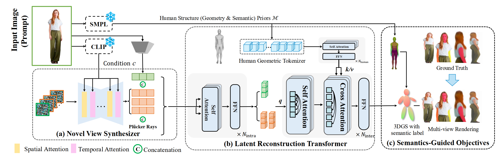
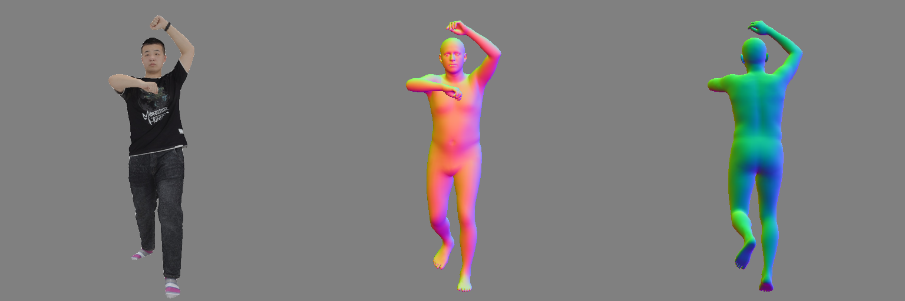

<h1>HumanSplat: Generalizable Single-Image Human Gaussian Splatting with Structure Priors</h1>

<div class="is-size-6 publication-authors">
  <span class="author-block">
    <a href="https://paulpanwang.github.io/">Panwang Pan</a><sup>1*</sup>,</span>
  <span class="author-block">
    <a href="https://suzhuo.github.io/">Zhuo Su</a><sup>1*†</sup>,</span>
  <span class="author-block">
    <a href="https://chenguolin.github.io/">Chenguo Lin</a><sup>1,2*</sup>,
  </span>
  <span class="author-block">
    <a href="https://openreview.net/profile?id=~Zhen_Fan2">Zhen Fan</a><sup>1</sup>,
  </span>
  <a href="https://openreview.net/profile?id=~Yongjie_zhang2"><span class="author-block">
    Yongjie Zhang</a><sup>1</sup>,
  </span>
  <span class="author-block">
    <a href="https://www.zemingli.com/">Zeming Li</a><sup>1</sup>,
  </span>
  <span class="author-block">
    <a href="/">Tingting Shen</a><sup>3</sup>,
  </span>
  <span class="author-block">
    <a href="http://www.muyadong.com/">Yadong Mu</a><sup>2</sup>,
  </span>
  <span class="author-block">
    <a href="https://www.liuyebin.com/">Yebin Liu</a><sup>4‡</sup>
  </span>
</div>

<div class="is-size-5 publication-authors">
  <span class="author-block"><sup>1</sup>ByteDance,</span>
  <span class="author-block"><sup>2</sup>Peking University,</span>
  <span class="author-block"><sup>3</sup>Xiamen University,</span>
  <span class="author-block"><sup>4</sup>Tsinghua University</span>
</div>
<div class="is-size-6 publication-authors">
* denotes equal contribution, † denotes project leader, ‡ denotes corresponding author
</div>


 [](https://arxiv.org/abs/2406.12459)  [](https://humansplat.github.io/) [](https://github.com/humansplat/humansplat) [](./LICENSE)



<strong> HumanSplat predicts 3D Gaussian Splatting properties from a single input image in a generalizable manner.</strong>


## 🔥 See Also

You may also be interested in our other works:
- [**[NeurIPS 2025] PartCrafter**](https://github.com/wgsxm/PartCrafter): a 3D-native DiT that can directly generate 3D objects in multiple parts.
- [**[ICLR 2025] DiffSplat**](https://github.com/chenguolin/DiffSplat): directly fine-tune a text-to-image diffusion model to generate general 3D objects.


## 📊  Dataset
Download human datasets ([Thuman2.0](https://github.com/ytrock/THuman2.0-Dataset), [2K2K](https://github.com/SangHunHan92/2K2K) and [Twindom](https://web.twindom.com/)) and organize them as follows:
```bash
${ROOT} 
├──📂data/
    ├──📂Thuman2/
       ├── 📂0000/
       ├── 📂...
       ├── 📂0525/
    ├──📂2K2K/
       ├── 📂00003/
       ├── 📂...
       ├── 📂04739/
    ├──📂Twindom/

```

## 🔧  Installation
(1) Register an account and run `bash settings/fetch_hps.sh`:

(**Register an username & password for [pixie](https://pixie.is.tue.mpg.de/index.html) and [SMPLX](https://smpl-x.is.tue.mpg.de/index.html) is required**)
```bash
bash settings/fetch_hps.sh
```

(2) Additionally install dependencies and setup the environment:
```bash
bash settings/setup.sh
```

### HPS (Human Pose and Shape) Estimation
<details>
<summary>🚀 HPS Usage</summary>

 ```bash
# init revebg, load pretrained models, and predict HPS
python3 src/predit_hps.py
```
 

</details>


## 🚀 Usage
The code has been recently tidied up for release and could perhaps contain bugs. Please feel free to open an issue.


## 📚 Citation
 If you find our work useful for your research, please consider citing and starring the repo ⭐. Thank you very much.

```bibtex
@inproceedings{pan2024humansplat,
  title={HumanSplat: Generalizable Single-Image Human Gaussian Splatting with Structure Priors}, 
  author={Pan, Panwang and Su, Zhuo and Lin, Chenguo and Fan, Zhen and Zhang, Yongjie and Li, Zeming and Shen, Tingting and Mu, Yadong and Liu, Yebin},
  booktitle={Advances in Neural Information Processing Systems (NeurIPS)},
  year={2024}
}
```
